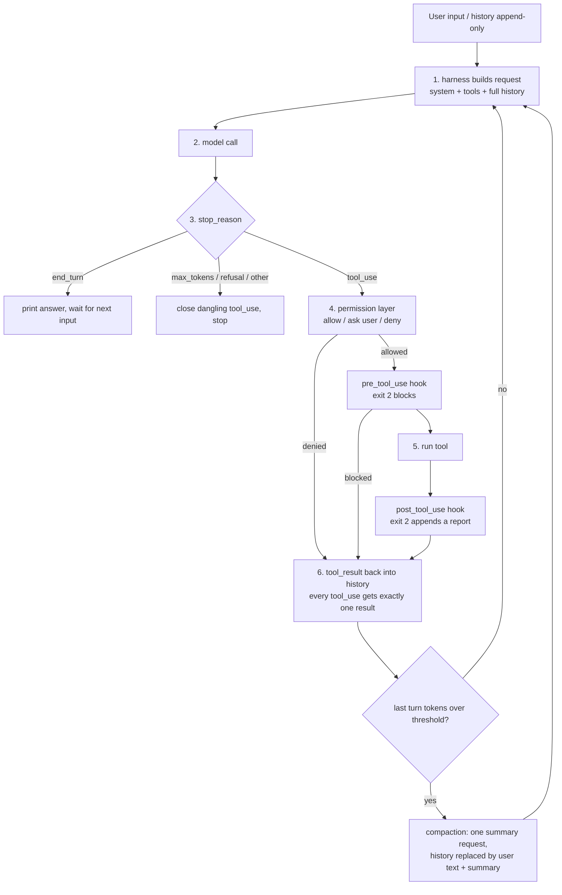

# harness-from-scratch

An agent harness built from scratch: the loop, tools, permissions, context management, memory, subagents and hooks that sit around the model in a Claude-Code-style coding agent, written directly on the Anthropic Messages API (no agent framework, no SDK tool runner). Built in stages v0–v4, with an experiment and a written completion criterion at every stage.

English | [繁體中文](README.zh-TW.md)

> **How this was built, stated plainly.** The author (Jadiouo) wrote the original specification ([`docs/HANDOFF.md`](docs/HANDOFF.md)), chose and approved a design at each stage from the options proposed, and ran every real-API experiment in their own terminal. The code, tests and documentation were written by Claude Code (orchestrated by Claude Opus 5.5, implemented by Claude Sonnet subagents). Each stage was additionally reviewed by an independent Sonnet reviewer, recorded in [`docs/PROGRESS.md`](docs/PROGRESS.md). So this repository shows design, experiment and verification work, not hand-typing every line.

## What it is

`agent.py` is a single file (about 960 lines) containing the whole loop: it assembles a request, calls the model, branches on `stop_reason`, runs tools behind a permission layer and hooks, writes `tool_result` blocks back into an append-only history, and compacts that history when it grows. Eight tools: `read_file`, `write_file`, `edit`, `grep`, `glob`, `bash`, `todo_write`, `task` (subagent). On top of that: permission layer, client-side compaction, project memory (`CLAUDE.md`), TODO list, read-only subagent, pre/post tool hooks.

The point is understanding, so the comments explain why, each section header names its harness role, and each stage has a write-up in `docs/`. The system prompt, tool descriptions and docs are in Traditional Chinese; that language is itself one of the experimental variables, and whether results carry over to English was not tested.

## Results

Every experiment below is a **single run (n=1)**. They are demonstrations, not statistics; cross-run variance was not measured. Evidence levels follow `docs/PROGRESS.md`: (1) deterministic mechanism fact, (2) single measured value, (3) single behavioral observation.

| # | Finding | Level | Evidence |
| --- | --- | --- | --- |
| 1 | **One sentence in a tool description changed tool choice, but did not save tokens.** Baseline: 4 of 6 turns used `bash cat/find`, 0 uses of `grep`/`glob`/`read_file`. After adding "do not read or search files with bash, use the dedicated tools" to the `bash` description: `glob` 3, `read_file` 4, 0 bypasses. Total tokens went up, 31,830 to 36,445, partly because a path mistake in the task prompt cost two extra turns. | 3 | [`v1-A-baseline`](evidence/logs/v1-A-baseline.jsonl), [`v1-B-bash-desc`](evidence/logs/v1-B-bash-desc.jsonl); PROGRESS "v1 真實測驗 A / B" |
| 2 | **The compaction (summary) request was rejected with HTTP 400** because a thinking block's signature is bound to the system prompt, tools and history of the conversation that produced it ("The `system` prompt differs from the one this block was created with"). Fix: the summary request reuses the same system prompt and tools and only appends an instruction. | 1 | [`v3-run1-bindfail`](evidence/logs/v3-run1-bindfail.jsonl) (`compaction_failed` row); PROGRESS "v3 真實測驗第 1 次" |
| 3 | **A TODO tool described only in its tool description was never used (0 calls in 90 tool calls); one sentence in the system prompt changed that** (6 calls in 91 tool calls, a 5-item plan on turn 2, updated after every compaction). Confound: compactions fell at different points in the two runs, so the drop in re-reads (31 to 25 `read_file`) cannot be credited to the list. | 3 | [`v4-todo-run1-nohint`](evidence/logs/v4-todo-run1-nohint.jsonl), [`v4-todo-run2-hint`](evidence/logs/v4-todo-run2-hint.jsonl); PROGRESS "v4-2 真實測驗" |
| 4 | **A subagent cut the main conversation's peak context but cost more tokens overall.** Main conversation: 2 turns vs 7; highest per-turn input 6,026 vs 10,164 (excluding the summary request); same correct answer. Total: 67.5k (main 11,240 + subagent 56,306) vs 56.3k (main 43,235 + summary request 13,071), about 20% more. The subagent returned 2,638 characters out of 18,830 it read (14%). | 2 | [`v4-sub-run-task`](evidence/logs/v4-sub-run-task.jsonl), [`v4-sub-run-control`](evidence/logs/v4-sub-run-control.jsonl); PROGRESS "v4-3 真實測驗" |

Two things in the table are expectations that did not hold (token savings in row 1, cost savings in row 4), and one is the opposite of what was predicted (row 3). They are kept because they are the useful part. Other results (project memory saves one trial-and-error turn; a post hook's feedback was enough for the model to switch from `print` to `logging`; the 4-compaction run under an artificially low threshold) are in PROGRESS.

Quality signal: 270 offline tests (a scripted `FakeClient`, no API calls), including tests of the evaluation scripts themselves. For example, a new judge item is checked against a real log recorded before the fix, to prove it would have failed.

Logs and how to replay them: [`evidence/`](evidence/README.md).

## Architecture



Sections of `agent.py` (each carries a `# ==== 【harness 角色：…】` header):

| Section | What it does |
| --- | --- |
| Config | Model, effort, turn limit, compaction threshold, workdir, all via environment variables |
| Tool definitions | The tool schemas and descriptions the model sees; wording drives behavior |
| Output truncation | Keeps head and tail of long tool output so it cannot fill the context |
| Tool executor | Does the work for each tool call |
| Permission layer | Allow-list rules; ask the user for writes and unknown commands; deny paths outside `WORKDIR` |
| Hooks | User scripts around tool calls (`.agent/hooks.json`); fail-open |
| Logging | One jsonl record per request/response, for replay |
| Project memory | Loads `sandbox/CLAUDE.md` into the system prompt once and freezes it |
| Request assembly | Packs system, tools and history into one API call |
| Agent loop | Call model, branch on `stop_reason`, run tools, write results back |
| Subagent | `task` opens a fresh read-only conversation and returns only its conclusion |
| Compaction | Replaces the whole history with the user's text plus a summary |
| REPL | Terminal loop and slash commands; never breaks `tool_use`/`tool_result` pairing |

## Stages

| Stage | Completion criterion (from the spec) | Result | Write-up |
| --- | --- | --- | --- |
| v0 minimal loop | Told to "create hello.py and run it", it writes, runs and reports | Met in 3 turns; the model recovered from `python` exit 127 by using `python3` | [v0](docs/v0-%E8%AA%AA%E6%98%8E.md) |
| v1 search tools | Given an unfamiliar repo, search then read then precisely edit | Not met with the default tool descriptions; met after one sentence change (row 1) | [v1](docs/v1-%E8%AA%AA%E6%98%8E.md) |
| v2 permissions | After one rejection, the model gets the feedback and changes course | Met, but the rejection reason itself told the model what to do, so this shows "reads the stated reason", not "changes course unprompted" | [v2](docs/v2-%E8%AA%AA%E6%98%8E.md) |
| v3 context management | A task with 30+ tool calls does not blow the context | 91 tool calls, 4 compactions, input back to about 3.7k-4.1k after each; the threshold (8,000 tokens) is artificially low, so this checks that compaction works, not that the task would otherwise overflow | [v3](docs/v3-%E8%AA%AA%E6%98%8E.md) |
| v4 advanced | Main agent delegates a repo-wide search and keeps its own context clean | Memory, TODO, subagent and hooks done; see rows 3 and 4 | [v4](docs/v4-%E8%AA%AA%E6%98%8E.md) |

Completion thresholds in the judge script (for example "subagent result under 20% of what it read") are rules of thumb, not derived values.

## Quick start

Requires Python 3.10+ (developed on 3.11) and access to `claude-opus-5-5`.

```bash
git clone https://github.com/Jadiouo/harness-from-scratch.git
cd harness-from-scratch
python3 -m venv .venv
.venv/bin/pip install -r requirements.txt
cp .env.example .env && chmod 600 .env     # then put your key in ANTHROPIC_API_KEY
.venv/bin/python -m pytest -q tests/       # 270 tests, offline, a few seconds
.venv/bin/python agent.py "create hello.py and run it"
.venv/bin/python scripts/summarize_log.py evidence/logs/v4-sub-run-task.jsonl   # replay a published log, no API key
```

Defaults can be overridden by environment variables (`MODEL`, `EFFORT`, `MAX_TURNS`, `COMPACT_AT_TOKENS`, `PERMISSION_MODE`, `USE_FALLBACKS`). By default the request also sends the `server-side-fallback-2026-07-01` beta header; `USE_FALLBACKS=0` turns it off. Logs from your own runs go to `logs/` (git-ignored). To rerun an experiment, copy the fixture into `sandbox/` and use the task prompt in [`fixtures/README.md`](fixtures/README.md). Run `summarize_log.py` right after the run, because some judge items read the current state of `sandbox/`.

## Safety

- **The bash permission layer is string matching, not a security boundary.** An approved script can do anything the user can. Run the agent only in the disposable `sandbox/` directory, ideally inside a container or VM.
- **Hooks run arbitrary shell commands with your user permissions**, without a prompt, and the hook script is re-read on every call.
- Treat `.env` like any secret; the bash tool strips `ANTHROPIC_*` variables from its environment, but the permission layer is the only thing stopping the model from reading files you can read.

## Limitations

- **n=1 everywhere.** No repeated runs, no confidence intervals. Behavioral results are "this task, this run".
- **v2 is confounded** (see the Stages table); whether a bare rejection with no reason would change the model's course was not tested.
- **v3 uses an artificial threshold** and a task prompt that forbids scripting around the work (an earlier run bypassed the test that way).
- **One model** (`claude-opus-5-5`) and one prompt language (Traditional Chinese). The beta header and model may not be available to every account.
- **Only referenced logs are published**: 14 of the local logs, de-identified. Others are not included.
- Comparisons with Claude Code are marked "comparison only, not verified" in the docs. Some background claims (thinking-signature binding, prompt-cache prefix) come from vendor documentation, not from this project's measurements.
- Known gaps: `grep` has no timeout on model-supplied regexes; module-level mutable state (`TODOS`, `SESSION_SYSTEM`, and so on) is a deliberate single-file simplification, and the first thing I would change is moving it into a `Session` object; interrupting with Ctrl-C labels already-executed tools as not run.

## Repo map

| Path | Contents |
| --- | --- |
| `agent.py` | The whole harness, one file |
| `tests/test_agent.py` | 270 offline tests, ordered v0 to v4; search prefixes like `test_v3_judge` for tests of the evaluation scripts |
| `scripts/summarize_log.py` | Per-turn log summary and executable completion-criteria judges |
| `scripts/sanitize_logs.py` | Copies and de-identifies referenced logs into `evidence/logs/` |
| `fixtures/` | Task repositories, hook script, memory file and task prompts for each experiment |
| `evidence/` | Published experiment logs and their index |
| `docs/` | Spec (`HANDOFF.md`), progress log (`PROGRESS.md`), per-stage write-ups, and the [simulated review](docs/review/01-%E9%96%89%E9%96%80%E6%9C%83%E8%AD%B0-%E7%AC%AC1%E8%BC%AA-20261024.md) |
| `CLAUDE.md` | Project notes for Claude Code |

## License

[MIT](LICENSE).
