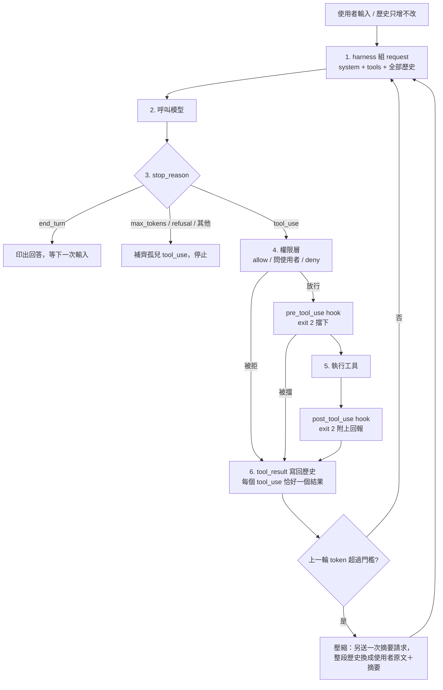

# coding-agent-from-scratch

一個手寫的、Claude Code 風格的 coding agent：直接用 Anthropic Messages API，不用 agent 框架，也不用 SDK 的 tool runner。分 v0–v4 五個階段做，目的是看清楚 harness 到底在做什麼；每個階段都有實驗和寫明的完成標準。

[English](README.md) | 繁體中文

> **這個專案怎麼做出來的，直接說清楚。** 作者（Jadiouo）寫了原始規格（[`docs/HANDOFF.md`](docs/HANDOFF.md)），在每個階段從提出的設計中做選擇並核可，並在自己的終端機執行了所有真實 API 實驗。程式碼、測試與文件由 Claude Code 撰寫（Claude Opus 5.5 統籌、Claude Sonnet subagent 實作），每個階段另由獨立的 Sonnet 審查，紀錄在 [`docs/PROGRESS.md`](docs/PROGRESS.md)。所以這個 repo 展示的是設計、實驗與驗證的工作，不是逐行親手打字。

## 這是什麼

`agent.py` 是單一檔案（約 960 行），包含完整的迴圈：組 request、呼叫模型、依 `stop_reason` 分支、在權限層與 hooks 之後執行工具、把 `tool_result` 寫回只增不改的歷史，歷史太長時壓縮。共八個工具：`read_file`、`write_file`、`edit`、`grep`、`glob`、`bash`、`todo_write`、`task`（subagent）。另有權限層、client 端 compaction、專案記憶（`CLAUDE.md`）、TODO 清單、唯讀 subagent、工具前後 hooks。

重點是理解，所以註解寫的是「為什麼」，每個區段標頭都標明 harness 角色，每個階段在 `docs/` 都有說明文件。system prompt、工具描述與文件都是繁體中文；這個語言本身也是實驗變因之一，結果在英文下是否相同沒有測。

## 結果

以下每個實驗都是**只跑 1 次（n=1）**，屬示範，不是統計結論，跨次變異沒有量。證據分級沿用 `docs/PROGRESS.md`：(1) 決定性機制事實，(2) 單次量測值，(3) 單次行為觀察。

| # | 發現 | 等級 | 證據 |
| --- | --- | --- | --- |
| 1 | **工具描述改一句，模型的工具選擇變了，但 token 沒有省。** 基線：6 輪中 4 輪用 `bash cat/find`，`grep`／`glob`／`read_file` 都是 0 次。在 `bash` 描述加上「不要用 bash 讀檔或搜尋，改用專用工具」之後：`glob` 3、`read_file` 4、0 次繞過。總 token 反而變多，31,830 到 36,445，部分原因是任務句的路徑寫錯多花了 2 輪。 | 3 | [`v1-A-baseline`](evidence/logs/v1-A-baseline.jsonl)、[`v1-B-bash-desc`](evidence/logs/v1-B-bash-desc.jsonl)；PROGRESS「v1 真實測驗 A／B」 |
| 2 | **壓縮（摘要）請求被 API 以 HTTP 400 拒絕**：thinking 區塊的簽章綁定產生它的那段對話的 system prompt、tools 與歷史（「The `system` prompt differs from the one this block was created with」）。修法：摘要請求沿用同一份 system 與 tools，只附加一段指示。 | 1 | [`v3-run1-bindfail`](evidence/logs/v3-run1-bindfail.jsonl)（`compaction_failed` 那一行）；PROGRESS「v3 真實測驗第 1 次」 |
| 3 | **TODO 工具只靠工具描述，模型 0 次使用（90 次工具呼叫）；在 system prompt 補一句後就用了**（91 次工具呼叫中 6 次，第 2 輪列出 5 項清單，每次壓縮後都先更新清單）。混淆：兩次實驗的壓縮落點不同，所以重讀減少（`read_file` 31 到 25）不能歸功於清單。 | 3 | [`v4-todo-run1-nohint`](evidence/logs/v4-todo-run1-nohint.jsonl)、[`v4-todo-run2-hint`](evidence/logs/v4-todo-run2-hint.jsonl)；PROGRESS「v4-2 真實測驗」 |
| 4 | **subagent 降低了主對話的 context 峰值，但總 token 反而更多。** 主對話 2 輪對 7 輪；單輪 input 最高 6,026 對 10,164（不含摘要請求）；答案都正確。總量：67.5k（主對話 11,240＋subagent 56,306）對 56.3k（主對話 43,235＋摘要請求 13,071），多約 2 成。subagent 讀了 18,830 字元的工具結果，只回給主對話 2,638 字元（14%）。 | 2 | [`v4-sub-run-task`](evidence/logs/v4-sub-run-task.jsonl)、[`v4-sub-run-control`](evidence/logs/v4-sub-run-control.jsonl)；PROGRESS「v4-3 真實測驗」 |

表中有兩項是預期落空（第 1 列省 token、第 4 列省成本），一項與預測相反（第 3 列）。保留它們，因為這正是有用的部分。其他結果（專案記憶省掉一次試錯、post hook 的回報足以讓模型把 `print` 改成 `logging`、人為低門檻下壓縮 4 次的長任務）寫在 PROGRESS。

品質指標：270 個離線測試（腳本化的 `FakeClient`，不打 API），其中包含對評估腳本本身的測試；例如新增的判定項目會用修改前錄的真實 log 驗證它確實會判 FAIL。

log 與重播方式見 [`evidence/`](evidence/README.md)。

## 架構



`agent.py` 的區段（每段都有 `# ==== 【harness 角色：…】` 標頭）：

| 區段 | 做什麼 |
| --- | --- |
| 設定 | 模型、effort、輪數上限、壓縮門檻、工作目錄，全由環境變數決定 |
| 工具定義 | 模型看到的工具 schema 與描述；用字直接影響行為 |
| 輸出截斷 | 長輸出只留頭尾，避免灌滿 context |
| 工具執行器 | 真正執行每個工具呼叫 |
| 權限層 | 白名單規則；寫檔與未知指令問使用者；`WORKDIR` 外的路徑直接 deny |
| hooks | 掛在工具前後的使用者腳本（`.agent/hooks.json`）；壞掉時放行（fail-open） |
| 紀錄 | 每次 request／response 寫一行 jsonl，供回放 |
| 專案記憶 | 啟動時把 `sandbox/CLAUDE.md` 載入 system prompt 並凍結 |
| request 組裝 | 把 system、tools、歷史打包成一次 API 呼叫 |
| agent loop | 呼叫模型、依 `stop_reason` 分支、執行工具、寫回結果 |
| subagent | `task` 開一段全新的唯讀對話，只回傳結論 |
| 上下文管理 | 把整段歷史換成使用者原文加摘要 |
| REPL | 終端機輸入與斜線指令；不破壞 `tool_use`／`tool_result` 配對 |

## 各階段

| 階段 | 完成標準（出自規格） | 結果 | 說明 |
| --- | --- | --- | --- |
| v0 最小迴圈 | 叫它「建立 hello.py 並執行」，能寫檔、跑、回報 | 3 輪達成；模型看到 `python` exit 127 後改用 `python3` | [v0](docs/v0-%E8%AA%AA%E6%98%8E.md) |
| v1 搜尋工具 | 給陌生 repo，先搜、再讀、再精準修改 | 預設工具描述下未達成；改一句描述後達成（第 1 列） | [v1](docs/v1-%E8%AA%AA%E6%98%8E.md) |
| v2 權限層 | 拒絕一次後，模型收到回饋並改走別的路 | 達成，但拒絕理由本身就告訴模型該怎麼做，所以證明的是「模型會讀理由並照辦」，不是「無提示下自己換方法」 | [v2](docs/v2-%E8%AA%AA%E6%98%8E.md) |
| v3 上下文管理 | 30 輪以上工具呼叫的任務不爆 context | 91 次工具呼叫、壓縮 4 次，每次壓縮後 input 回到約 3.7k–4.1k；門檻（8,000 tokens）是人為壓低的，所以驗證的是壓縮機制會運作，不是證明沒有壓縮就會爆 | [v3](docs/v3-%E8%AA%AA%E6%98%8E.md) |
| v4 進階 | 主 agent 把整個 repo 的搜尋丟給 subagent，自己的 context 保持乾淨 | 記憶、TODO、subagent、hooks 皆完成；見第 3、4 列 | [v4](docs/v4-%E8%AA%AA%E6%98%8E.md) |

判定腳本裡的門檻（例如「subagent 回傳少於它讀到內容的 20%」）是經驗值，不是推導出來的。

## 快速開始

需要 Python 3.10 以上（開發環境為 3.11）以及 `claude-opus-5-5` 的使用權限。

```bash
git clone https://github.com/Jadiouo/coding-agent-from-scratch.git
cd coding-agent-from-scratch
python3 -m venv .venv
.venv/bin/pip install -r requirements.txt
cp .env.example .env && chmod 600 .env     # 然後把 key 填進 ANTHROPIC_API_KEY
.venv/bin/python -m pytest -q tests/       # 270 個測試，離線，數秒
.venv/bin/python agent.py "建立 hello.py 並執行"
.venv/bin/python scripts/summarize_log.py evidence/logs/v4-sub-run-task.jsonl   # 重播已發布的 log，不需要 API key
```

預設值可用環境變數覆寫（`MODEL`、`EFFORT`、`MAX_TURNS`、`COMPACT_AT_TOKENS`、`PERMISSION_MODE`、`USE_FALLBACKS`）。預設 request 還會帶 `server-side-fallback-2026-07-01` beta 標頭，`USE_FALLBACKS=0` 可關掉。自己跑出來的 log 寫在 `logs/`（已 gitignore）。要重跑實驗，把 fixture 複製進 `sandbox/`，任務句見 [`fixtures/README.md`](fixtures/README.md)。跑完要立刻執行 `summarize_log.py`，因為部分判定項目讀的是 `sandbox/` 的現況。

## 安全提醒

- **bash 權限層是字串規則，不是安全邊界。** 使用者核准過的腳本可以做使用者能做的任何事。只在丟棄式的 `sandbox/` 資料夾裡跑，最好再放進容器或 VM。
- **hooks 以使用者權限執行任意 shell 指令**，不會詢問，而且每次呼叫都重讀 hook 腳本。
- `.env` 當成機密處理；bash 工具的環境會移除 `ANTHROPIC_*` 變數，但能擋住模型去讀你讀得到的檔案的，只有權限層。

## 限制與誠實聲明

- **全部都是 n=1。** 沒有重複實驗、沒有信賴區間；行為結論只能讀成「這個任務、這一次」。
- **v2 有混淆**（見各階段表）；沒有理由的單純拒絕是否會讓模型改變做法，沒有測。
- **v3 用人為門檻**，而且任務句禁止用腳本繞過（先前一次實驗就是被這樣繞過的）。
- **單一模型**（`claude-opus-5-5`）、單一提示語言（繁體中文）。beta 標頭與模型不一定每個帳號都能用。
- **只帶出被引用的 log**：14 份、已去識別化；其餘本機 log 不在 repo 裡。
- 與 Claude Code 的比較在文件中都標為「僅比較，未驗證」。部分背景說法（thinking 簽章綁定、prompt cache 吃前綴）來自廠商文件，不是本專案的實測。
- 已知缺口：`grep` 對模型給的 regex 沒有逾時；模組層的可變狀態（`TODOS`、`SESSION_SYSTEM` 等）是單檔學習用的刻意簡化，若要改，第一件事是收進 `Session` 物件；Ctrl-C 中斷時，已執行的工具會被標成「未執行」。

## Repo 地圖

| 路徑 | 內容 |
| --- | --- |
| `agent.py` | 整個 harness，單一檔案 |
| `tests/test_agent.py` | 270 個離線測試，依 v0 到 v4 排列；搜尋 `test_v3_judge` 這類前綴可找到評估腳本的測試 |
| `scripts/summarize_log.py` | 逐輪摘要 log，並把完成標準寫成可執行的判定 |
| `scripts/sanitize_logs.py` | 把被引用的 log 複製並去識別化到 `evidence/logs/` |
| `fixtures/` | 各實驗用的任務 repo、hook 腳本、記憶檔與任務句 |
| `evidence/` | 已發布的實驗 log 與索引 |
| `docs/` | 規格（`HANDOFF.md`）、進度檔（`PROGRESS.md`）、各階段說明，以及[模擬審查](docs/review/01-%E9%96%89%E9%96%80%E6%9C%83%E8%AD%B0-%E7%AC%AC1%E8%BC%AA-20261024.md) |
| `CLAUDE.md` | 給 Claude Code 的專案說明 |

## 授權

[MIT](LICENSE)。
